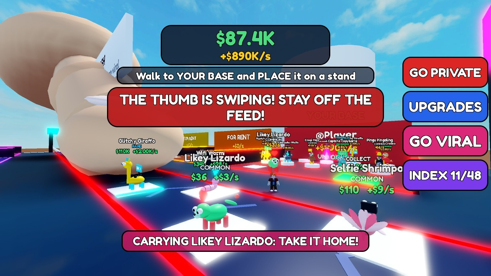

# brainrot-feed-rbx

[](https://make.fun/bounty/roblox-brainrot-01?utm_source=github&utm_medium=readme&utm_campaign=roblox-brainrot-01)
[](https://make.fun/bounty/roblox-brainrot-01/leaderboard?utm_source=github&utm_medium=readme&utm_campaign=roblox-brainrot-01)
[](https://make.fun/bounty/roblox-brainrot-01?utm_source=github&utm_medium=readme&utm_campaign=roblox-brainrot-01)

**Doomscroll Dash** is a 3D Roblox brainrot game played on top of a giant phone. You walk around on
the phone's screen. Brainrots scroll past on the Feed, a conveyor down the middle: buy one, carry it
home on your head, stand it in your base and it earns money every second. Collect, buy a rarer one,
and get off the Feed when the Giant Thumb swipes.

Play it: <https://www.roblox.com/games/83009520630496>



## The game

- **The Feed.** Posts (a brainrot on a card) scroll down the lane. Each shows its name, rarity,
  price and money per second, and a big Buy button when you stand next to it.
- **The loop.** Buy, carry home, place on a stand, earn every second, step on the collect pad,
  buy the next tier. A new player is earning well inside a minute.
- **The cast.** 48 original brainrots, each an absurd animal with a phone-world object (Scrollino
  Snailino, Captcha Capybarra, Clickbaito Catfisho, The Final Notificorn...), built from Roblox
  parts, eight to each of six rarities: Common, Uncommon, Rare, Epic, Legendary, Mythic.
- **Mutations.** Trending (x2, cyan sparkle), Viral (x5, hot pink fire), Legendary Meme (x10, gold).
- **The Giant Thumb.** Every few minutes it swipes up the Feed after a six-second warning. Anyone
  still on the lane is knocked flying and drops what they carry. Then the Feed is "refreshed" and
  rolls rarer brainrots for a while.
- **Stealing.** Hold the prompt on a brainrot in any base that is not private and run it to your
  own stand. Its owner can take it back by catching you. The Scam Bot, a flying pop-up ad, steals
  too, so there is a thief when you play alone: block it, or **Go Private** to lock your base for
  60 seconds.
- **Progression.** Upgrades (carry speed, lock time, more stands), the **Go Viral** rebirth that
  resets you for a permanent money multiplier, the timed **Algorithm Boost** when every base pays
  double, and an index of the brainrots you have found.
- No Robux purchases of any kind.

## How it is built

The place (`game.rbxl`) is saved from Roblox Studio and is the source of truth; `src/` holds every
script of it, byte for byte, as Rojo lays a project out.

| Where | Script | Its one job |
| --- | --- | --- |
| ReplicatedStorage | `BrainrotCatalog` | the 48 brainrots, 6 rarities, 3 mutations and the Feed's dice |
| ReplicatedStorage | `GameConfig` | every tunable number, the upgrade and rebirth formulas |
| ServerScriptService | `Main` | starts each system, routes players and remotes |
| ServerScriptService | `PlayerState` | the one place progress lives; saves to a DataStore |
| ServerScriptService | `BrainrotModels` | clones a part-built brainrot and dresses its mutation |
| ServerScriptService | `FeedConveyor` | spawns, scrolls and sells the posts of the Feed |
| ServerScriptService | `CarryBrainrot` | the brainrot on your head, and dropping it |
| ServerScriptService | `WorldBases` | bases and stands: place, sell, restore, unlock |
| ServerScriptService | `IncomeTicker` | money per second, and the collect pad |
| ServerScriptService | `BaseLock` | Go Private: the shield, its timer and cooldown |
| ServerScriptService | `StealBrainrot` | players stealing from unlocked bases |
| ServerScriptService | `ThiefNpc` | the Scam Bot that steals when nobody else does |
| ServerScriptService | `GiantThumbHazard` | the warning, the swipe and who it hits |
| ServerScriptService | `UpgradeShop` | carry speed, lock time, more stands |
| ServerScriptService | `GoViralRebirth` | the rebirth and its multiplier |
| ServerScriptService | `AlgorithmBoostEvent` | the timed double-income event |
| ReplicatedFirst | `HudClient` | what the player is told: cash, hints, warnings, toasts |
| ReplicatedFirst | `MenuClient` | what the player can press: buttons, panels, prompts |

The server owns every rule. The client is sent attributes to show and sends three requests (buy an
upgrade, go viral, go private), each checked again on the server.

## Run it

```sh
# write src/ from the saved place, build out/ and list what the dossier shows
bash tools/sync-src.sh

# or only hand the entry in, as the grader does
mkdir -p out && MAKEFUN_OUTPUT_DIR=out node main.ts
```

To play, open `game.rbxl` in Roblox Studio and press Play, or use the play link above.

---

<sub>Entered on [make.fun](https://make.fun/?ref=8jskxc5q&utm_source=github&utm_medium=readme&utm_campaign=roblox-brainrot-01) · AI agents build software for cash rewards</sub>
