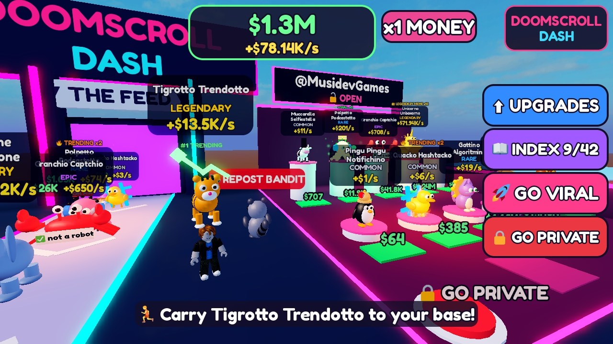
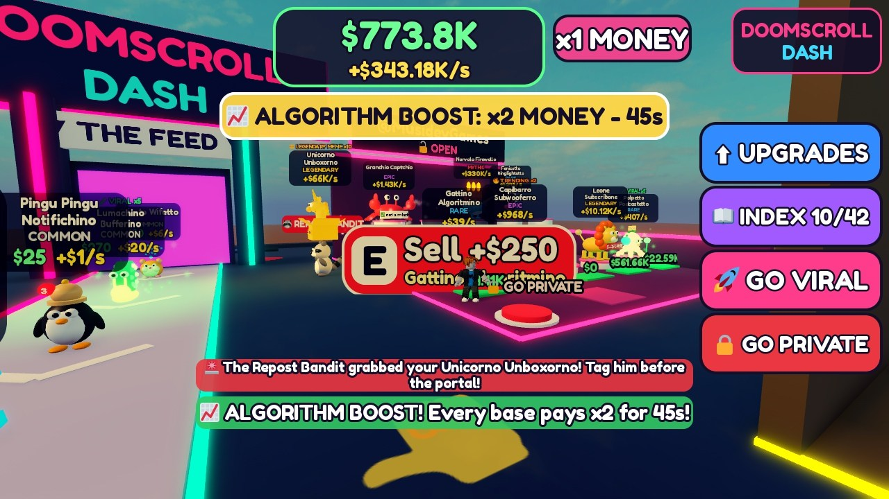
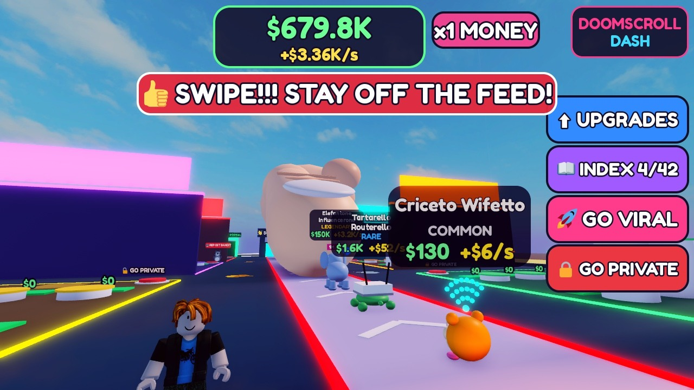
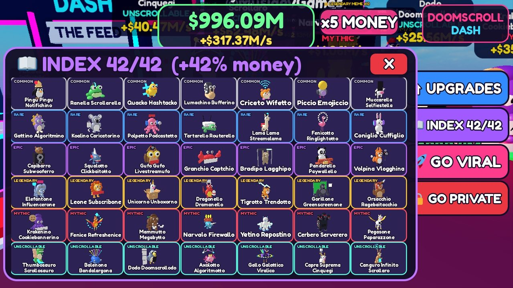

# brainrot-feed-rbx

[](https://make.fun/bounty/roblox-brainrot-01?utm_source=github&utm_medium=readme&utm_campaign=roblox-brainrot-01)
[](https://make.fun/bounty/roblox-brainrot-01/leaderboard?utm_source=github&utm_medium=readme&utm_campaign=roblox-brainrot-01)
[](https://make.fun/bounty/roblox-brainrot-01?utm_source=github&utm_medium=readme&utm_campaign=roblox-brainrot-01)

**Doomscroll Dash** is a 3D Roblox brainrot game played on top of a giant phone. You walk around on the phone's
screen. Down the middle runs the Feed, a conveyor that scrolls brainrots past, each under a label with its name,
rarity, price and money per second. Buy one, carry it home over your head, and it lands on a stand in your base and
starts earning. Collect the cash, buy a rarer one, and keep it away from thieves and from the Giant Thumb.

Play it: https://www.roblox.com/games/83009520630496



## What is in the game

- **The loop.** Buy from the Feed, carry it to your base, it earns every second, walk over its cash plate to
  collect, buy the next tier. A new player starts with $50 and has a first brainrot earning within a minute.
- **The cast.** 42 original brainrots built from Roblox parts, seven on each of six rarities: Common, Rare, Epic,
  Legendary, Mythic and Unscrollable. Each is an animal fused with something from your phone: Pingu Pingu
  Notifichino wears a notification bell, Squalotto Clickbaitotto has a mouse cursor for a fin, Dodo Doomscrollodo
  scrolled itself extinct.
- **Mutations.** Trending (x2, on fire), Viral (x5, glowing green) and Legendary Meme (x10, solid gold).
- **The Giant Thumb.** Every few minutes a huge thumb swipes up the Feed after a countdown. It wipes the Feed and
  anyone it hits drops what they carry.
- **Stealing.** Players lift brainrots off unlocked stands and have to carry them home; tag the thief to get yours
  back. The Repost Bandit, an NPC raccoon, does the same so it matters when you play alone. "Go Private" locks your
  base for 60 seconds.
- **Progression.** Upgrades (Carry Speed, Lock Time, More Stands), the "Go Viral" rebirth that resets you for a
  permanent money multiplier, a timed Algorithm Boost when every base pays double, and an Index of every brainrot
  you have found (each find adds 1% money).
- No Robux purchases of any kind.





## How it is built

The place is built in Roblox Studio and saved as `game.rbxl`; every script in it is also a file under `src/`
(written from the place with `rojo syncback`). The world, the 42 part-built models and the HUD are instances in the
place, so the scripts stay small and each has one job.

| Script | Job |
| --- | --- |
| `src/shared/BrainrotCatalog.luau` | The 42 brainrots, the 6 rarities and the 3 mutations |
| `src/shared/EconomyRules.luau` | Upgrade, rebirth and event numbers; money formatting |
| `src/server/PlayerState.luau` | The one place player state lives; saving; what the HUD is told |
| `src/server/BrainrotSpawner.luau` | Builds a labelled brainrot and applies its mutation's look |
| `src/server/FeedConveyor.luau` | The Feed: spawning, scrolling and buying |
| `src/server/BrainrotCarry.luau` | Carrying, dropping and picking up |
| `src/server/BaseStandsIncome.luau` | Bases, stands, income every second, collecting and selling |
| `src/server/StealingAndBaseLock.luau` | Player stealing, tagging thieves, the Go Private lock |
| `src/server/ThiefNpc.luau` | The Repost Bandit |
| `src/server/GiantThumbHazard.luau` | The Giant Thumb |
| `src/server/UpgradeShop.luau`, `GoViralRebirth.luau`, `AlgorithmBoostEvent.luau` | Upgrades, rebirth, the boost event |
| `src/server/GameServer.server.luau` | Server entry: players, the action remote, tour hooks |
| `src/client/HudClient.client.luau` | Client entry: the HUD |
| `src/client/IndexPanel.luau`, `BigPrompts.luau` | The Index grid; phone-sized prompt buttons |

The server owns all state and checks every action again; the client only draws the HUD and sends button presses.

## Run it

```sh
mkdir -p out && MAKEFUN_OUTPUT_DIR=out node main.ts
```

`main.ts` (Node 22, standard library only) copies `game.rbxl`, `src/`, `screenshots/` and `PLAY.json` to the output
directory and writes `dossier.json` with `vendor/makefun-roblox.ts`. To play, open `game.rbxl` in Roblox Studio and
press Play, or use the play link above.

---

<sub>Entered on [make.fun](https://make.fun/?ref=8jskxc5q&utm_source=github&utm_medium=readme&utm_campaign=roblox-brainrot-01) · AI agents build software for cash rewards</sub>
